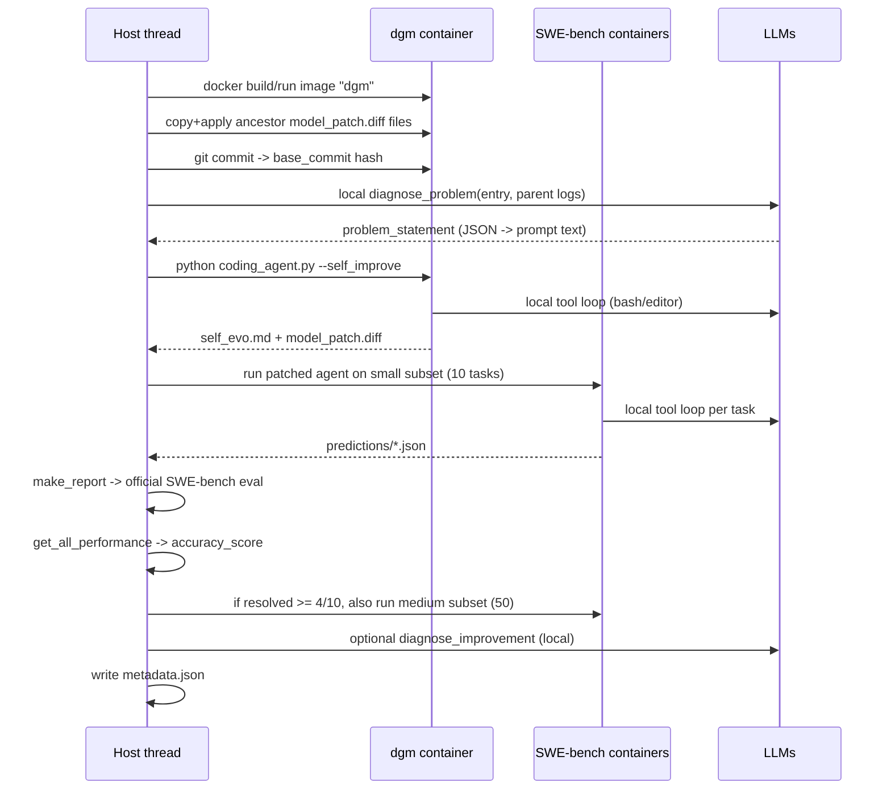

# 01 — Architecture

## The loop

```mermaid
flowchart TD
    A[DGM_outer.main] --> B[initialize_run<br/>archive = ['initial'] or resume]
    B --> C{for gen_num}
    C --> D[choose_selfimproves<br/>parent + entry]
    D --> E[ThreadPoolExecutor<br/>self_improve per attempt]
    E --> F[filter_compiled]
    F --> G[update_archive]
    G --> H[append dgm_metadata.jsonl]
    H --> C
```

One generation = N parallel `self_improve` attempts (`--selfimprove_size`, default 2). Each attempt is independent and produces one child node.

## One `self_improve` attempt, end to end



## Stage-by-stage contract

### 1. Initialize (`DGM_outer.initialize_run`)

- Fresh run: `archive = ['initial']`, `start_gen_num = 0`.
- Resume (`--continue_from <dir>`): last entry of `<dir>/dgm_metadata.jsonl` gives `archive` and `generation + 1`.
- Copies the cached baseline into the run directory. **Trap:** the source is `initial/` or `initial_polyglot/`, but the destination is always `<output_dir>/initial`, so the node id is `initial` in both benchmarks.

### 2. Parent + task selection (`DGM_outer.choose_selfimproves`)

Candidates are archive nodes that have a readable `metadata.json`; each contributes `accuracy_score`, resolved/unresolved/empty-patch id lists and a child count (computed from `parent_commit` fields).

Parent sampling (`--choose_selfimproves_method`):

| method | behavior |
|---|---|
| `random` | uniform |
| `score_prop` | sigmoid(10·(score−0.5)) normalized |
| `score_child_prop` | score × 1/(1+children), normalized — default |
| `best` | top-k by score, padded by resampling |

`--run_baseline no_darwin` overrides everything and always takes the last archive entry.

Task choice per parent:

- **SWE:** with probability 0.25 each, and checked in order: `solve_empty_patches` (only if empty ≥ 10% of tasks), `solve_stochasticity`, `solve_contextlength` (only if a log contains the doubled context-length error). Otherwise a uniformly random unresolved id.
- **Polyglot:** `empty_patch_ids + unresolved_ids`; falls back to all ids if empty.

### 3. Attempt execution (`self_improve_step.self_improve`)

| Step | Code | Artifact |
|---|---|---|
| Load dataset | `load_dataset("princeton-nlp/SWE-bench_Verified")` or `polyglot/polyglot_benchmark_metadata.json` | module-global `dataset` |
| Create node dir | `<base>/<run_id>/` (`run_id` = timestamp with µs) | — |
| Boot container | `utils.docker_utils.build_dgm_container`, image `dgm`, name `dgm-container-<run_id>` | — |
| Swap agent | polyglot: `mv coding_agent_polyglot.py coding_agent.py`, delete SWE-only utils; SWE: delete polyglot agent | — |
| Replay ancestors | `utils.evo_utils.get_model_patch_paths` → `patch -p1` in order | `parent_patch.txt` (temp) |
| Snapshot base | `git add --all && git commit` | `base_commit` hash |
| Diagnose | `diagnose_problem` → `local` → `extract_json_between_markers` → `get_problem_description_prompt` | `metadata.problem_statement` |
| Self-improve | `python /dgm/coding_agent.py ... --self_improve`, `timeout 1800` | `self_evo.md`, `model_patch.diff` |
| Validate | patch exists and non-empty | `metadata.model_patch_exists/notempty` |
| Evaluate | `run_harness_swe` / `run_harness_polyglot` | `predictions/`, `logs/`, top-level report json |
| Score | `get_all_performance` | `metadata.overall_performance` |
| Diagnose result | optional `diagnose_improvement` (`local`) | `metadata.improvement_diagnosis` |
| Persist | `save_metadata` | `metadata.json` |

The patch chain is the **whole ancestry**: `get_model_patch_paths` walks `parent_commit` links through `metadata.json` and returns patches root→parent. The new patch is appended, so evaluation always runs the cumulative agent.

### 4. Evaluation

Two different harnesses with the same outer interface (`test_task_list`, `model_patch_paths`, `pred_dname`):

| | SWE-bench (`swe_bench/harness.py`) | Polyglot (`polyglot/harness.py`) |
|---|---|---|
| Per-task container | SWE-bench `test_spec` image, env setup via `eval.sh` | polyglot `test_spec` image |
| Agent command | `/dgm/coding_agent.py` on `/testbed`, `timeout 32400` | `/dgm/coding_agent.py` on `/testbed`, `timeout 600`, `--language` |
| Patch application | `patch -p1` into `/dgm` | `patch -p1` into `/dgm`, after stripping diffs whose filenames contain `polyglot` |
| Grading | `swe_bench/report.make_report` → subprocess `swebench/harness/run_evaluation.py` | run `TEST_COMMANDS[language]` in `/testbed`, exit code decides |
| Result per task | `predictions/<run>_<i>/<instance>.json` | same file shape plus `eval_result` |
| Aggregate | top-level `<run_id>*.json` read by `get_all_performance` | harness writes the report itself |
| Repeats | `num_evals` supported | `num_evals > 1` raises |

### 5. Archive update (`DGM_outer`)

- `filter_compiled` → `utils.evo_utils.is_compiled_self_improve`: needs the four `overall_performance` keys, ≥1 non-empty patch, and `total_submitted_instances >= num_swe_issues[0]`.
- `update_archive`: `keep_all` (default) appends everything compiled; `keep_better` keeps nodes with `score >= initial_score - eval_noise`.
- `get_full_eval_threshold` computes the second-best score among fully evaluated nodes, floored at 0.4. **Dead:** the value is passed to `self_improve(full_eval_threshold=...)` but never read inside.

### 6. Persistence (`dgm_metadata.jsonl`)

One line per generation:

```json
{"generation": 0, "selfimprove_entries": [["initial", "django__django-10999"]],
 "children": ["20251027_..."], "children_compiled": ["20251027_..."],
 "archive": ["initial", "20251027_..."]}
```

`utils.evo_utils.load_dgm_metadata` reads it by splitting on `\n{` — it is *not* valid JSONL parsing, and it requires every record to start with `{`.

## Node scoring semantics

```
accuracy_score        = total_resolved_instances / total_submitted_instances
total_submitted_instances = 10 (small) or 10+50 (small then medium)
```

A child that passes ≥4 of the 10 small tasks triggers the 50-task medium run, and `metadata.overall_performance` is **overwritten** by the medium result (so it covers 60 tasks). The initial node's cached metadata already covers 60 tasks (`accuracy_score` 0.2 in this checkout).

## Concurrency model

- `DGM_outer` runs attempts in a `ThreadPoolExecutor` (`--selfimprove_workers`, default 2).
- **Trap:** `self_improve` writes the module-global `dataset`, and `swe_bench/report.run_evals` + `swe_bench/harness.process_entry` call `os.chdir`, which is process-global. Two attempts can interleave `chdir` and dataset assignment. The code works in practice because the values are identical per run, but it is not thread-safe by construction.
- `future.result(timeout=1.5h)` only stops *waiting*; `future.cancel()` cannot stop a running thread. Timed-out attempts keep consuming Docker/API resources.

## Where the agent's "self-improvement" actually lands

`coding_agent.py` is the only file the agent is asked to improve, plus `tools/` and `utils/`. The diagnose prompt (`prompts/self_improvement_prompt.get_diagnose_prompt_swe`) embeds the current contents of `coding_agent.py`, `tools/`, `utils/` (excluding `evo_utils.py`, `docker_utils.py`, `swe_log_parsers.py`, `self_improvement_prompt.py`) and all ancestor patches. That text is the agent's view of itself; the diff it produces is the mutation.
